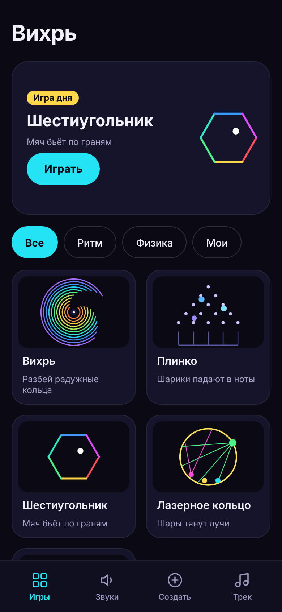
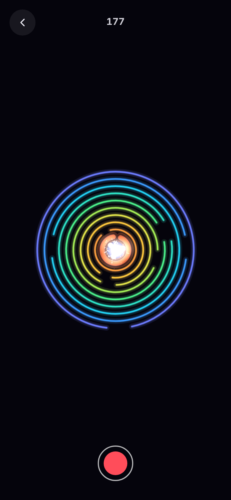
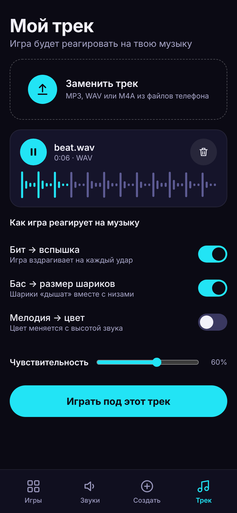
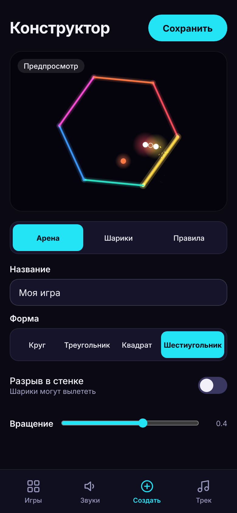

# Вихрь

Игры-залипашки для телефона: шарики сталкиваются и звучат, а игра танцует под твою музыку.
Это браузерная версия: на ней проверяем механику, звук и ощущения до того, как делать мобильное приложение.

<p>
  
  
  
  
</p>

## Что уже есть

- **6 игр**: Вихрь (радужные кольца), Туннель (900 колец на весь экран), Плинко, Шестиугольник, Лазерное кольцо, Лучи.
- **Звук от каждого касания**: 4 набора (Стекло, Капли, 8-бит, Бас) и 4 гаммы, поэтому любые столкновения звучат музыкально.
- **Свой трек**: загружаешь MP3/WAV/M4A, игра реагирует на бит (вспышки), бас (шарики «дышат») и мелодию (цвет).
- **Конструктор**: арена, шарики, гравитация и правила «когда → тогда». Сохранённые игры появляются в разделе «Мои».
- **Цвета колец**: 8 готовых палитр и свои два цвета, кнопка с палитрой прямо в игре.
- **Запись видео** игры со звуком (вертикальное, для TikTok и Reels).

## Как запустить

Нужен любой локальный сервер, потому что код разбит на модули (просто открыть `index.html` двойным кликом не получится).

```bash
# Вариант 1: Python
python3 -m http.server 8000

# Вариант 2: Node
npx serve .
```

Открой http://localhost:8000. Чтобы проверить на телефоне в той же Wi-Fi сети, открой `http://<IP компьютера>:8000`.

Звук включается после первого касания: так требуют браузеры.

## Структура

```
vihr-app/
├── index.html                 разметка всех экранов
├── manifest.webmanifest       чтобы добавить на главный экран телефона
├── assets/
│   ├── css/
│   │   ├── fonts.css          подключение шрифта
│   │   ├── tokens.css         цвета, размеры, радиусы (меняй тут)
│   │   ├── base.css           сброс и каркас
│   │   ├── components.css     кнопки, чипы, переключатели, меню
│   │   └── screens.css        стили отдельных экранов
│   ├── fonts/inter/           шрифт Inter (латиница + кириллица, лицензия OFL)
│   └── img/
│       ├── icons/sprite.svg   все иконки интерфейса
│       ├── games/             обложки игр
│       ├── logo.svg
│       └── favicon.svg
└── src/
    ├── main.js                точка входа
    ├── core/                  навигация, настройки, цикл игры, запись видео
    ├── audio/                 звуковой движок, наборы звуков, гаммы, анализ трека
    ├── physics/               физика: шарики, стенки, дуги, колышки
    ├── render/                неоновые эффекты, частицы, палитры цветов
    ├── games/                 сами игры + каталог (registry.js)
    └── ui/                    логика каждого экрана
```

## Как добавить новую игру

1. Создай файл в `src/games/`, унаследуй класс от `Game` (`src/games/base.js`).
2. В `setup()` построй мир: `this.world.arcs`, `segments`, `pegs`, шарики через `this.world.addBall()`.
3. Переопредели `onBallWall` / `onBallBall`: там вызывай `this.sound(нота, сила)`.
4. Нарисуй стенки в `drawWalls(ctx)`.
5. Добавь игру в `src/games/registry.js` и обложку в `assets/img/games/`.

## Технологии

Чистый JavaScript (ES-модули), Canvas 2D, Web Audio API, MediaRecorder. Без сборщиков и зависимостей.

## Что дальше

- Перенос на Unity или Godot для App Store и Google Play.
- Общая лента игр из конструктора и онлайн-комнаты.
- Больше наборов звуков и игр.
